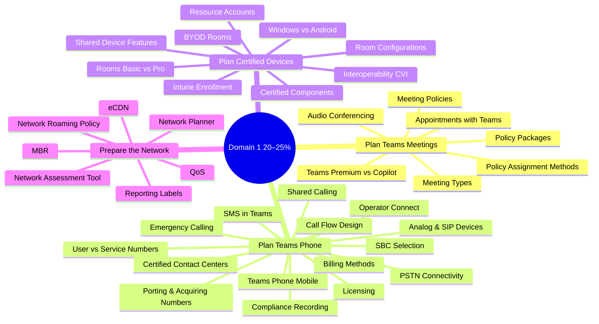
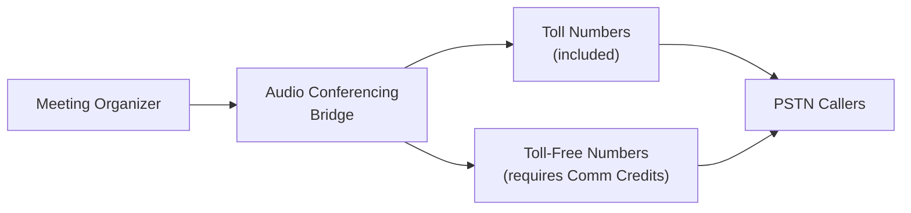
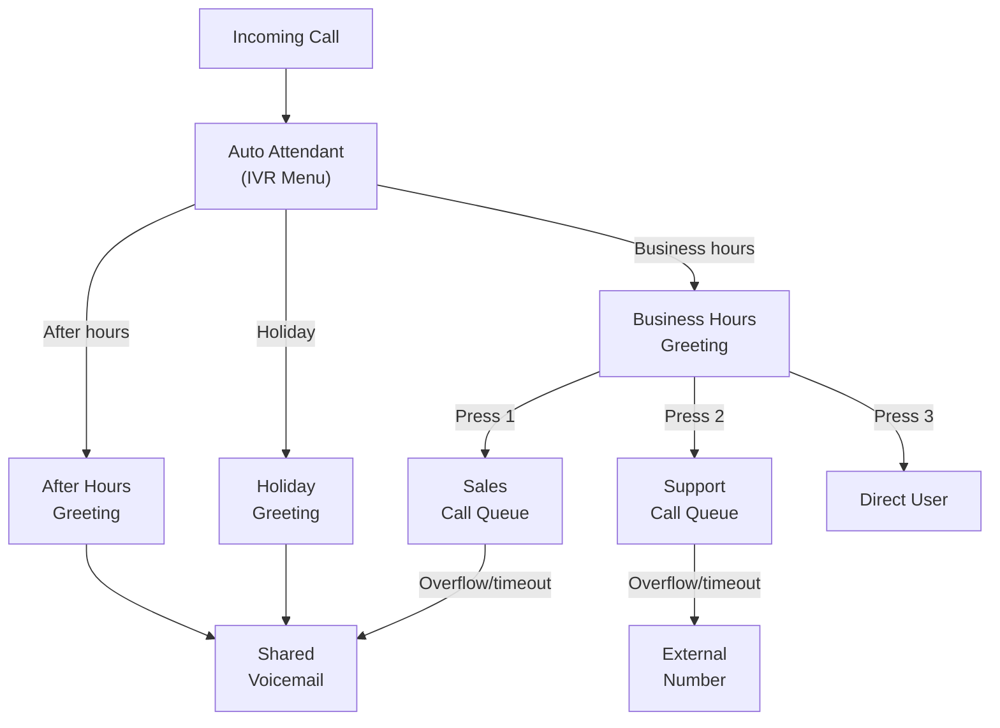
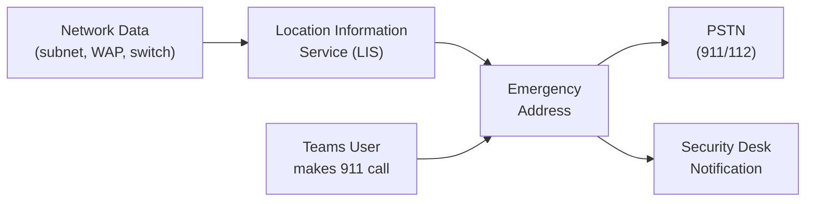
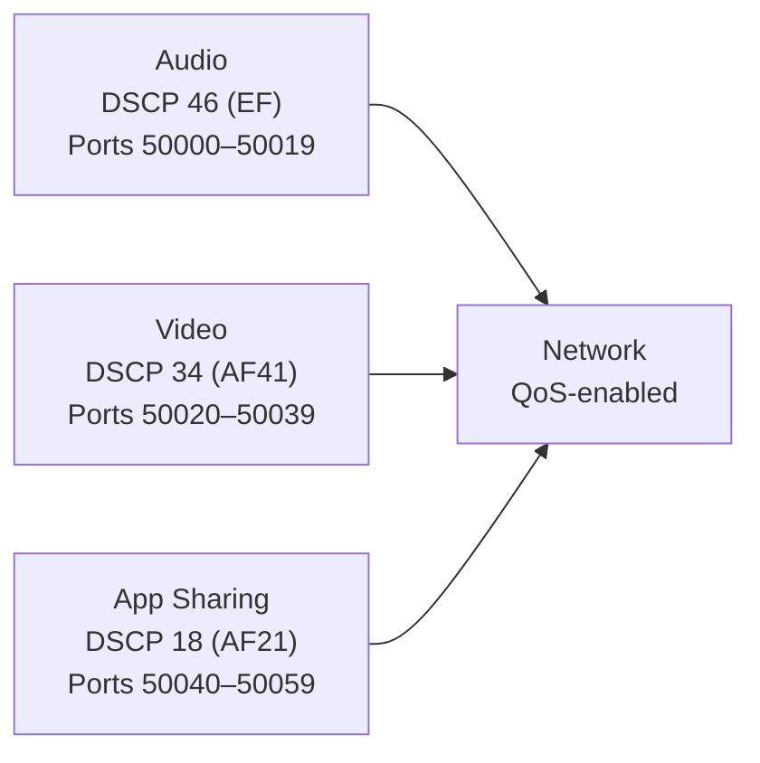

# 01 — Plan & Design Collaboration Communications Systems 20–25%
> - Based on: *[MS-721 Study Guide](https://learn.microsoft.com/en-us/credentials/certifications/resources/study-guides/ms-721)*
> - 📁 [← Back to Home](/ms-721-study-notes/)

---

## 🗺 Domain Overview

---

## 🎥 1.1 Plan and Design Teams Meetings

### Meeting Types Decision Matrix

| Requirement | Meeting | Webinar | Town Hall | Appointment (Bookings) |
|------------|---------|---------|-----------|-------------------|
| Interactive collaboration | ✅ | ❌ | ❌ | ✅ |
| Registration required | ❌ | ✅ | ❌ | ❌ |
| Large-scale broadcast | ❌ | ❌ | ✅ | ❌ |
| External customer-facing | ✅ | ✅ | ✅ | ✅ |
| Breakout rooms | ✅ | ✅ | ❌ | ❌ |
| Q&A feature | ✅ | ✅ | ✅ | ❌ |
| eCDN support | ❌ | ❌ | ✅ | ❌ |
| Max capacity | 1,000 interactive (+10,000 view-only on Enterprise plans) | 1,000 | 10,000 view-only (up to 100,000 with Attendee Capacity Pack) | Same as a Teams meeting |

> **⚠️ Exam Caveat:**
> - **Breakout rooms** work in meetings and in events with **up to 1,000 attendees** (webinars) — once attendance goes above 1,000, or in events optimized for large audiences (town halls), they aren't supported

### Appointments with Microsoft Teams

The study guide now says **"appointments with Microsoft Teams"** instead of "virtual appointments" — the name of Microsoft's overview page — and the **Virtual Appointments app is no longer available**. Business-to-customer appointments (bank advisor, clinician, interview) are now built from these pieces:

| Option | What It Does | Licensing |
|--------|-------------|-----------|
| **Microsoft Bookings** | Booking pages, staff calendars, scheduled and on-demand appointments held as Teams meetings; external guests join from a browser | Microsoft 365 (basic) — **Teams Premium** adds SMS reminders, the appointment queue, and usage analytics in the Teams admin center |
| **Virtual appointment meeting template** | Default Teams meeting template for meetings with external guests (customers, clients, patients) | Teams — SMS text notifications from the template need **Teams Premium** |
| **Teams EHR connector** | Clinicians launch Teams visits straight from **Oracle Health** or **Epic** | Microsoft Cloud for Healthcare or the EHR connector standalone offer |
| **Virtual appointment Graph API** | Embed appointment join links (waiting room, browser join) in your own app | Developer integration |

> **⚠️ Exam Caveat:**
> - "Virtual Appointments app" answers are outdated — recommend **Microsoft Bookings** (plus Teams Premium for SMS, queue, and analytics)
> - **SMS notifications** only reach phone numbers in a few countries (Australia, Canada, Netherlands, UK, US)
> - An appointment is still a **Teams meeting** — meeting policies and meeting limits apply

### Meeting Policies & Settings

Meeting policies control what features are available to meeting organizers and participants:

| Policy Setting | What It Controls |
|---------------|-----------------|
| **AllowMeetingRegistration** | Whether users can create webinars with registration |
| **AllowTranscription** | Live transcription in meetings |
| **AllowRecording** | Cloud recording capability |
| **AllowBreakoutRooms** | Breakout room creation |
| **AllowIPVideo** | Video in meetings |
| **MediaBitRateKb** | Maximum media bit rate for calls/meetings |
| **AllowMeetingCoach** | Speaker coach feature |
| **AllowWatermark** | Teams Premium watermark on video/shared content |

### PSTN Audio Conferencing

Audio Conferencing adds **dial-in phone numbers** to Teams meetings so participants can join via PSTN:

| Feature | Details |
|---------|---------|
| **Dedicated dial-in number** | Assigned per-user (default bridge number) |
| **Shared dial-in numbers** | Toll and toll-free numbers on the conference bridge |
| **Dial-out from meeting** | Call out to add PSTN participants |
| **Communication Credits** | Required for toll-free numbers and international dial-out |

> **⚠️ Exam Caveat:**
> - **Audio Conferencing** is included in M365 E5 but must be added separately for E3/E1
> - **Toll-free dial-in** requires **Communication Credits** to be set up
> - Each user gets a **default dial-in number** based on their usage location
> - **Dial-out policy** controls whether meeting organizers can dial out to PSTN numbers from meetings

### Teams Premium vs. Microsoft 365 Copilot

**Teams Premium** and **Microsoft 365 Copilot** are two separate per-user add-ons — neither one includes the other. The study guide now asks when to recommend each one:

| Requirement | Recommend | Notes |
|------------|-----------|-------|
| AI meeting recap (AI notes, tasks, chapters, name mentions) | **Teams Premium** *or* **Microsoft 365 Copilot** | Intelligent recap is the one overlap — either license works (transcription must be allowed) |
| Ask questions about a meeting during or after it | **Microsoft 365 Copilot** | Copilot in Teams meetings — not part of Teams Premium |
| Audio recap, or recap without saving a transcript | **Microsoft 365 Copilot** | Copilot-only recap options |
| Live translated captions and transcripts | **Teams Premium** | Organizer-level feature |
| Custom branding (meeting themes, org backgrounds) | **Teams Premium** | |
| Watermarks, end-to-end encryption, sensitivity labels, "who can record" | **Teams Premium** | Sensitivity labels for meetings also need an E5-level Purview subscription |
| Admin-created meeting templates, custom policy packages | **Teams Premium** | |
| Bookings SMS reminders, appointment queue, appointment analytics | **Teams Premium** | See Appointments with Microsoft Teams above |
| Queues app (supervisor tools, real-time and historical queue metrics) | **Teams Premium** | Also requires a **Teams Phone** license |
| Advanced webinars and town halls (waitlist, manual approval, eCDN, RTMP-In) | **Neither** — an **Enterprise plan** | Moved from Teams Premium to Office 365 / Microsoft 365 E-plans on **April 1, 2026** |

> **⚠️ Exam Caveat:**
> - **Copilot in meetings** needs a **Microsoft 365 Copilot** license — Teams Premium alone doesn't provide it
> - **Intelligent recap** works with **Teams Premium or Copilot** — don't buy both just for recap
> - Copilot isn't available in **end-to-end encrypted** meetings (E2EE is a Teams Premium feature)
> - Since **April 1, 2026**, advanced event features come with **Enterprise plans** (Office 365 E1/E3/E5, Microsoft 365 E3/E5/E7), not Teams Premium. Teams Premium licenses bought before that date keep the old features until they expire
> - Teams Premium is an **add-on**: users still need a Teams license

### Policy Assignment Methods

| Method | Best For | Tool |
|--------|---------|------|
| **Direct assignment** | Individual users | Teams Admin Center or PowerShell |
| **Group policy assignment** | Microsoft 365 groups, security groups, distribution lists | Teams Admin Center or PowerShell |
| **Batch assignment** | Large sets of users (up to 5,000 per batch) | Teams Admin Center or PowerShell |
| **Policy packages** | Role-based bundles (e.g., frontline worker) | Teams Admin Center or PowerShell |

> **⚠️ Exam Caveat:**
> - **Policy precedence**: Direct assignment > Group policy assignment (lowest rank number wins) > Global (org-wide default)
> - **Policy packages** bundle multiple policy types (calling, meeting, messaging, app setup) into a single assignable unit
> - Built-in policy packages are free — **custom policy packages** need a **Teams Premium** license for every targeted user
> - Teams Premium features require the **Teams Premium** license even if the user has M365 E5

---

## 📞 1.2 Plan and Design Teams Phone and PSTN Connectivity

### Licensing Requirements

| User Type | Required License |
|-----------|-----------------|
| Regular user | Teams Phone Standard + PSTN connectivity (Calling Plan / Operator Connect / Direct Routing) |
| Shared device (common area phone) | **Teams Shared Space** license (named *Teams Shared Devices* until April 2026) — Teams Phone is included; add a Calling Plan only if you don't use Direct Routing or Operator Connect |
| Resource account (AA/CQ) | Teams Phone Resource Account (free) + Virtual User or Calling Plan if phone number needed |

### PSTN Connectivity Comparison

| Feature | Calling Plans | Operator Connect | Direct Routing |
|---------|--------------|-----------------|----------------|
| **SBC required?** | No | No (operator-managed) | Yes (customer-managed) |
| **Number management** | Microsoft | Operator | Customer/carrier |
| **Emergency calling** | Automatic | Operator-managed | Customer configures |
| **Country availability** | Limited | Depends on operator | Any (SBC required) |
| **Complexity** | Low | Medium | High |
| **Best for** | Small/medium orgs, quick deployment | Mid-size orgs, existing carrier relationship | Large orgs, complex requirements, existing PSTN |

### Shared Calling

Shared Calling allows multiple users to **share a single phone number** for outbound calls while receiving inbound calls to their own extension:

| Aspect | Details |
|--------|---------|
| **Use case** | Frontline workers, shared spaces, users who rarely make outbound PSTN calls |
| **Licensing** | Teams Phone Standard (no individual Calling Plan needed per user) |
| **How it works** | A resource account with a phone number is shared; outbound calls show the shared number |
| **Inbound calls** | Users can still be reached via their Teams identity (extension dialing) |

### Billing Methods

| Method | Description |
|--------|-------------|
| **Domestic Calling Plan** | Included minutes for domestic calls per user/month |
| **International Calling Plan** | Includes domestic + international minutes |
| **Pay-as-you-go (PAYG)** | Per-minute billing — no committed minutes |
| **Communication Credits** | Pre-paid pool for toll-free and overage minutes |

### User vs. Service Phone Numbers

Every Teams phone number has a **number usage** that decides what it can be assigned to:

| Number Usage | Assigned To | Number Types | Use It For |
|--------------|-------------|--------------|-----------|
| **User** (subscriber) | Users and devices — including common area phones and Teams Rooms | Geographic (toll) only | A person's or a device's direct number |
| **Voice app** (service) | Resource accounts of **auto attendants** and **call queues** | Toll or toll-free | Main line, help desk, sales line |
| **Conference** (service) | **Audio Conferencing** bridge | Toll or toll-free | Dedicated dial-in numbers for meetings |

> **⚠️ Exam Caveat:**
> - A **service number** handles **hundreds of simultaneous calls**, while a user number handles only a few. Put a busy main line on a service number behind an auto attendant or call queue, not on a user
> - **Toll-free** numbers can only be **Voice app** or **Conference** numbers, never user numbers
> - Toll-free numbers need **Communication Credits** set up and funded before you can reserve and use them
> - You can change a number's usage later (for example **User → Voice app**), as long as the target has the right licenses

### Porting and Acquiring Phone Numbers

Teams Phone licenses don't include phone numbers. You get them from whoever provides your PSTN connectivity:

| PSTN Connectivity | Get New Numbers | Port Existing Numbers |
|-------------------|-----------------|-----------------------|
| **Calling Plan** | Teams admin center → **Voice → Phone numbers → Add** (needs at least one Calling Plan license in the tenant). For a specific area code, use **Get phone number support** | Teams admin center → **Voice → Phone numbers → Port** (port wizard + Letter of Authorization) |
| **Operator Connect** | Order from the operator, which **uploads** the numbers to your tenant | The operator ports them, then uploads them |
| **Teams Phone Mobile** | From the mobile operator (SIM-enabled numbers) | The operator ports them |
| **Direct Routing** | From your own carrier. The numbers stay on your carrier and SBC | Port them to your carrier, then optionally **upload** them to the Teams number inventory (see 03 §3.6) |

**What the port wizard needs (porting to Calling Plans):**

| Item | Details |
|------|---------|
| **Letter of Authorization (LOA)** | Signed by the account's **authorized user**, by e-signature or as an uploaded signed copy |
| **Account details** | Organization name, account number, account PIN, service address. They must match the current carrier's records **exactly** |
| **Billing telephone number (BTN)** | **Full port**: all numbers including the BTN, and the old account closes. **Partial port**: only some numbers (you can name a replacement BTN) |
| **Number usage** | Set each number to **User**, **Voice app** or **Conference** (toll-free numbers default to Voice app) |
| **Status** | **Voice → Phone numbers → Order history**: for example *Pending operator approval*, *Approved (FOCAccepted)*, *Completed* |

> **⚠️ Exam Caveat:**
> - The losing carrier rejects a port when the **LOA** has missing or wrong details (compare it with the carrier's **Customer Service Record**) or the numbers have a **porting freeze**. Fix it and resubmit
> - Lead times and rules depend on the country. In the US a port takes about **5–12 business days**, with up to **999 numbers per order**. Some countries don't support partial ports
> - Moving **Direct Routing** numbers to another connectivity option? Unassign them and **release** them from the Teams inventory (`New-CsOnlineTelephoneNumberReleaseOrder`) before the port
> - Numbers need an **emergency address**. In the US you assign it with the number; in some countries (for example the UK) you give it when you acquire or port the number
> - Questions about a port order go to the **Telephone Number Services (TNS) Service Desk**

### SMS in Teams with Calling Plan Numbers

Users with a **Microsoft Calling Plan number** can send and receive SMS in Teams chat:

| Aspect | Details |
|--------|---------|
| **Where** | **United States** (including Puerto Rico) and **Canada** only, in the public cloud (not GCC) |
| **Licenses** | Teams + **Teams Phone** + **Microsoft Calling Plan**, plus a Calling Plan number assigned to a voice-enabled user |
| **Registration** | US and Canadian business texting runs over the **10DLC** network. Before any number can be enabled, register a **Brand** and a **Campaign** with **The Campaign Registry (TCR)** from the Teams admin center |
| **Limits** | **One** brand and **one** campaign per tenant. A campaign enables up to **49** numbers by default |
| **Enable** | **Voice → Phone numbers → Numbers** → select the number → **Enable SMS** (activation can take up to two hours) |
| **Included messages** | Pooled across the tenant: **200** per Domestic or Domestic + International plan, **100** per Domestic 120, **0** for pay-as-you-go. A message over **160** characters counts as several segments, and overages are billed per segment |
| **Reporting** | **Analytics & reports → Usage reports → PSTN and SMS Usage** |

> **⚠️ Exam Caveat:**
> - SMS works only on **Calling Plan** numbers, so not on Direct Routing or Operator Connect numbers, and not on numbers assigned to **resource accounts**
> - Only **10-digit long codes** can send. Toll-free numbers, short codes and alphanumeric sender IDs aren't supported
> - SMS works in **one-to-one chats only**, with no MMS, attachments, emojis or GIFs
> - Brand and campaign registration is required **even if you never send marketing messages**
> - Overages need a billing method (**Communication Credits** or postpaid billing), which is mandatory for **pay-as-you-go** Calling Plans

### Call Flow Design — Auto Attendants & Call Queues

> **⚠️ Exam Caveat:**
> - Auto attendants can **nest** — an AA can route to another AA or to a call queue
> - Call queues support multiple **routing methods**: Attendant (everyone rings), Serial, Round Robin, Longest Idle
> - **Resource accounts** are required for both auto attendants and call queues
> - Auto attendants handle **business hours**, **after hours**, and **holiday** schedules independently

### Emergency Calling Design

| Component | Purpose |
|-----------|---------|
| **Emergency addresses** | Physical locations registered with PSTN provider |
| **Emergency locations (places)** | More granular — floor, wing, building within an address |
| **Emergency calling policies** | Define how emergency calls are routed and who is notified |
| **Emergency call routing policies** | For Direct Routing — define which PSTN gateway handles 911/112 |
| **Location Information Service (LIS)** | Maps network information (subnet, WAP, switch, port) to emergency locations |
| **Dynamic emergency calling** | Automatically determines caller location based on network data |

> **⚠️ Exam Caveat:**
> - **Dynamic emergency calling** requires LIS configuration with network elements (subnets, WAPs, switches, ports)
> - For **Direct Routing**, emergency call routing policies define which SBC/gateway routes the emergency call
> - **Security desk notification** can be configured to alert on-site security when an emergency call is made
> - Emergency addresses must be **validated** with the PSTN provider before they can be used

### SBC Selection & Direct Routing Planning

| Consideration | Details |
|---------------|---------|
| **Certified SBCs** | Must be on the [Microsoft certified SBC list](https://learn.microsoft.com/en-us/MicrosoftTeams/direct-routing-border-controllers) |
| **SBC placement** | Can be on-premises or cloud-hosted (Azure, AWS, etc.) |
| **High availability** | Deploy redundant SBCs for failover |
| **Survivable Branch Appliance (SBA)** | Maintains calling capability during internet outages at branch offices |
| **Media bypass** | Routes media directly between user and SBC (reduces latency) |
| **Local Media Optimization (LMO)** | Keeps media traffic local within branch offices |

> **⚠️ Exam Caveat:**
> - **SBAs** are recommended for branch offices where internet connectivity is unreliable
> - **Media bypass** reduces latency and bandwidth usage by keeping media off the Microsoft cloud
> - The SBC must present a **trusted TLS certificate** with the SBC FQDN in the CN or SAN
> - **Location-Based Routing (LBR)** restricts toll bypass based on user's geographic location

### Analog Devices, SIP Handsets, and SIP Devices

| Device | Connect It With | What You Get |
|--------|-----------------|-------------|
| **Teams-certified phone** | Signs in to Teams directly | The full Teams calling and meetings experience |
| **SIP desk phone or IP-DECT handset** (Poly, Yealink, AudioCodes, Cisco with multiplatform firmware…) | **SIP Gateway**: compatible devices only, factory-reset and enrolled from the Teams admin center | Basic calling: make and receive calls, hold, transfer, voicemail with message waiting indicator, DTMF, dial in to meetings |
| **Analog phone, fax machine, overhead pager** | An **Analog Telephony Adapter (ATA)** behind a **certified SBC** (Direct Routing), or a compatible ATA registered through **SIP Gateway** | Calls between the analog device, Teams users and the PSTN, routed by voice routes through the SBC |

> **⚠️ Exam Caveat:**
> - With Direct Routing, the **ATA must be supported by the SBC vendor**. Microsoft lists verified ATAs on the certified SBC page
> - Analog devices behind an ATA **aren't searchable** in Teams, so users dial the device's number
> - **SIP Gateway** users need **Teams Phone**, PSTN connectivity and a **phone number**, and a SIP device can only call users who have phone numbers
> - SIP devices can be **call queue agents**, but not with **presence-based routing** (SIP Gateway doesn't publish presence)
> - SIP Gateway offboards stale devices: signed-in devices after **30 days** offline, signed-out devices after **14 days**
> - You can mix connectivity: keep Calling Plans or Operator Connect for users and use **Direct Routing only for the analog devices**

### Certified Contact Center Solutions

Teams **auto attendants** and **call queues** (plus the **Queues app** with Teams Premium) cover simple queuing. Recommend a **certified contact center (CCaaS)** solution when the organization needs:

- Business tools and workflows that drive the **customer journey**, such as CRM data and case history
- **Skill-based routing** and **automated virtual assistants** that gather information before an agent answers
- **Context for agents**: notes that pull data from several systems before the call starts
- Routing designed **down to the individual agent**, with measurement of interaction quality

| Integration Model | How It Connects to Teams | Typical Fit |
|-------------------|--------------------------|-------------|
| **Connect** | The provider's **certified SBC** + **Direct Routing** (multi-tenant SIP trunking) | An existing CCaaS platform with its own agent client, which can see Teams users' availability and transfer calls to them |
| **Extend** | Teams client platform and **Graph Cloud Communications APIs**. Agents work **inside Teams**, which is their calling endpoint | Agents use the Teams client, with the CCaaS app in Teams |
| **Unify** | **Azure Communication Services** (Call Automation, Calling SDK) on Teams calling infrastructure (*Teams Phone extensibility*) | New AI-driven CCaaS apps built natively on Teams Phone |

> **⚠️ Exam Caveat:**
> - Choose from Microsoft's list of **certified Microsoft Teams solutions for contact centers**. Certification means the solution was checked for quality, compatibility and reliability
> - In the **Connect** model, agents using the CCaaS client **don't need a Teams Phone license**, but Teams users who receive transferred calls need **Teams Phone** and a **phone number**

---

## 🏢 1.3 Plan and Design Teams-Certified Device Solutions

### Room Configuration Decision Matrix

| Room Size | Recommended Solution | Key Components |
|-----------|---------------------|----------------|
| **Focus room** (1–2 people) | Teams display or personal device | Monitor, webcam, speaker |
| **Small room** (2–6 people) | Teams Rooms on Android | Touch console, soundbar, camera |
| **Medium room** (6–12 people) | Teams Rooms on Windows or Android | Compute module, display(s), camera, microphone array |
| **Large room** (12–20+ people) | Teams Rooms on Windows | Dual displays, PTZ camera, ceiling microphones, content camera |
| **BYOD room** | No compute — bring your own laptop | Display, USB peripherals, room booking panel |

### Teams Rooms: Windows vs. Android

| Feature | Windows | Android |
|---------|---------|---------|
| **Compute** | Dedicated Windows PC (mini-PC / NUC) | All-in-one or soundbar with integrated compute |
| **Cost** | Higher | Lower |
| **Customization** | XML config file, GPO, high flexibility | Configuration profiles in TAC, simpler |
| **Dual displays** | ✅ | Limited |
| **Content camera** | ✅ | ❌ |
| **Peripheral support** | Wider range | More limited |
| **Management** | Intune + Pro Management portal | Intune (AOSP) + Pro Management portal |
| **Best for** | Large/complex rooms | Small/medium rooms, quick deployment |

### Teams Rooms Basic vs. Pro

| Feature | Basic (Free) | Pro |
|---------|-------------|-----|
| **Max rooms** | **25 per tenant** | **Unlimited** |
| **Join meetings** | ✅ | ✅ |
| **Screen sharing** | ✅ | ✅ |
| **Remote management** | ❌ | ✅ (Pro Management portal) |
| **Advanced analytics** | ❌ | ✅ |
| **Intune enrollment** | ❌ | ✅ |
| **Copilot features** | ❌ | ✅ |

### Interoperability Solutions

| Solution | Use Case |
|----------|----------|
| **Cloud Video Interop (CVI)** | Connect third-party video systems (Cisco, Poly) to Teams meetings |
| **Direct Guest Join** | Teams Rooms joins Cisco Webex or Zoom meetings natively |
| **SIP Guest Join** | Third-party SIP/H.323 devices join Teams meetings via SIP |

### Resource Account Requirements

Each Teams Room device requires a **resource account** with:

| Requirement | Details |
|-------------|---------|
| **Account type** | Room resource account (room mailbox in Exchange) |
| **License** | Teams Rooms Basic or Teams Rooms Pro |
| **Password** | Must not expire (configure in Entra) |
| **Conditional Access** | May need MFA exclusions for room accounts |

> **⚠️ Exam Caveat:**
> - **Resource accounts** for rooms are different from resource accounts for auto attendants/call queues
> - Room accounts need **Exchange Online** mailbox capability for calendar integration
> - **Conditional Access MFA exceptions** are often needed for room accounts that sign in non-interactively
> - **Intune enrollment** is available only with **Teams Rooms Pro** license
> - **AOSP** (Android Open Source Project) management is used for Android-based Teams devices

### Advanced Features on Shared Devices

Shared devices sign in with an account licensed with **Teams Shared Space** (named *Teams Shared Devices* until April 2026). One license covers one device:

| Shared Device | Use Case |
|---------------|----------|
| **Common area phone** (Teams phone) | Lobby, reception, break room, factory floor |
| **Android mobile phone** as a shared device | Frontline workers sharing a handset for calls (**no chat** with this license) |
| **Teams panel** | Outside a BYOD room |
| **Desk dock** | Bookable desk |

| Feature | What It Adds | How to Turn It On |
|---------|--------------|-------------------|
| **Advanced calling** | Call park, **cloud voicemail**, call queues, auto attendants, **group call pickup**, forwarding rules | Teams admin center → **Teams devices → Phones → Configuration profiles** → **Advanced calling**, or on the phone: **Settings → Device settings → Admin only → Calling** |
| **Hotline (PLAR)** | Lifting the handset auto-dials a set number or contact | Configuration profile → **Enable hotline**, with **Advanced calling off** |
| **Hot desking** | A user signs in temporarily on a shared phone | **IP phone policy** (`AllowHotDesking`, idle timeout) |
| **Call park** | Park a call and pick it up from another phone | **Off by default** on common area phones, so assign a **call park policy** |
| **Calling features** | Private calls, call forwarding, simultaneous ring | **Calling policy** |

> **⚠️ Exam Caveat:**
> - Common area phones start with the **basic calling** screen. **Advanced calling** has to be turned on, and the phone model must support it
> - The **Teams Shared Space** license includes **Teams Phone** and **Exchange Online Plan 2** for voicemail only (no email or calendar)
> - A Teams Shared Space license only allows the **common area phone** interface. Another sign-in mode needs a different license, such as Microsoft 365 E3/E5
> - Common area phones can't be agents in a call queue that uses **presence-based routing**, because they don't report presence reliably
> - After assigning a policy, **sign out and back in** on the phone. It can take up to an hour to apply
> - A Shared Space license used for a **BYOD room or bookable desk** unlocks **3 free Single Space** licenses (4 spaces in all), but not when it's used for a **device**

---

## 🌐 1.4 Prepare the Network for Teams

### Network Assessment Tools

| Tool | Purpose | Type |
|------|---------|------|
| **Microsoft Teams Network Assessment Tool** | Tests UDP connectivity, packet loss, jitter, latency from client to Teams relay | Downloadable client |
| **Network Planner** (Teams Admin Center) | Calculates bandwidth requirements per site based on user counts and personas | Web-based |
| **Microsoft 365 Network Connectivity Test** | Tests network path to Microsoft front door, DNS, TCP/UDP | Web-based (connectivity.office.com) |

### Enterprise Content Delivery Network (eCDN)

Use eCDN when:
- Hosting **town halls** or large meetings with many viewers at the same site
- Network bandwidth to the site is constrained
- Multiple viewers at the same location would create bandwidth bottleneck

| eCDN Provider | Integration |
|---------------|-------------|
| **Microsoft eCDN** | Native integration in Teams |
| **Hive Streaming** | Third-party, peer-to-peer |
| **Kollective** | Third-party, intelligent caching |
| **Ramp** | Third-party |

### QoS Configuration

### Network Configuration Steps

| Step | Action |
|------|--------|
| 1 | Use **Network Assessment Tool** to verify UDP connectivity and media quality |
| 2 | Use **Network Planner** to calculate bandwidth per site |
| 3 | Configure **QoS** (DSCP marking) on endpoints and network devices |
| 4 | Set **Media Bit Rate (MBR)** policy to cap bandwidth per user |
| 5 | Create **network roaming policy** to control media settings based on network location |
| 6 | Configure **network topology** in Teams Admin Center (sites, subnets) |
| 7 | Upload **tenant data** for Call Quality Dashboard (CQD) reporting |
| 8 | Configure **reporting labels** for Call Analytics |

### Network Roaming Policy

Controls media behavior based on whether a user is on a managed or external network:

| Setting | Purpose |
|---------|---------|
| **AllowIPVideo** | Allow/block video on specific networks |
| **MediaBitRateKb** | Set maximum media bit rate per network |

### Call Quality Dashboard (CQD) Setup

| Configuration | Purpose |
|---------------|---------|
| **Tenant data upload** | Upload building, subnet, and endpoint data for location-aware reporting |
| **Reporting labels** | Custom labels for sites/buildings to organize CQD reports |
| **Network topology** | Map subnets to physical locations for call quality correlation |

> **⚠️ Exam Caveat:**
> - **Tenant data upload** for CQD can take up to **24 hours** to process
> - **Network topology** in Teams Admin Center is used for **both** CQD reporting and dynamic emergency calling (LIS)
> - **MBR (MediaBitRateKb)** limits the total media bandwidth per user — affects both audio and video quality
> - **QoS** must be configured on both endpoints (via GPO or Intune) AND network devices (routers, switches)

---

## 📝 Quick-Reference Scenarios

| Scenario | Answer |
|----------|--------|
| Organization needs phone system in a country where Calling Plans aren't available | **Direct Routing** or **Operator Connect** |
| Branch office needs calling during internet outages | **Survivable Branch Appliance (SBA)** |
| 5,000 employees need to watch a CEO broadcast with Q&A | **Town hall** (with eCDN if same location) |
| Small meeting room (4 people) needs low-cost Teams room | **Teams Rooms on Android** with Teams Rooms Basic license |
| Resource account for auto attendant needs a phone number | **Teams Phone Resource Account license** + **Virtual User** or **Calling Plan** license |
| Need to test if network is ready for Teams voice | **Microsoft Teams Network Assessment Tool** |
| Need to calculate bandwidth for 500 users at a site | **Network Planner** in Teams Admin Center |
| Large room needs content camera and dual displays | **Teams Rooms on Windows** |
| Third-party Cisco video system needs to join Teams meetings | **Cloud Video Interop (CVI)** |
| Emergency calls must route based on user's physical location | **Dynamic emergency calling** with **LIS** configuration |
| Bank customers must book video sessions with advisors and get SMS reminders | **Microsoft Bookings** + **Teams Premium** (SMS notifications) |
| Managers want to ask an AI what was decided in a meeting they missed | **Microsoft 365 Copilot** (recap alone: Teams Premium *or* Copilot) |
| Legal team needs watermarks and E2EE on board meetings | **Teams Premium** |
| US sales reps must text customers from their Teams number | **SMS in Teams** on **Calling Plan** numbers, after registering a Brand and Campaign with TCR |
| Main line must take dozens of calls at the same time | **Service (Voice app) number** on an auto attendant or call queue resource account |
| Company switches to Calling Plans and keeps its existing numbers | **Port** them in the Teams admin center with a signed **Letter of Authorization** |
| Factory still has fax machines and overhead pagers | **ATA** behind a **certified SBC** (Direct Routing) |
| Existing Poly and Yealink SIP desk phones must work with Teams | **SIP Gateway** (compatible devices, basic calling) |
| Customer service needs skill-based routing and CRM integration | **Certified contact center solution** (Connect, Extend or Unify model) |
| Lobby phone needs call park and voicemail | **Teams Shared Space** license + **Advanced calling** on the common area phone |

---

[← Previous: 00 — Teams Voice Fundamentals](/ms-721-study-notes/00-teams-voice-fundamentals/){: .btn .btn-outline .fs-5 .mr-2 }
[Next → 02 — Meetings, Webinars & Town Halls](/ms-721-study-notes/02-meetings-webinars-townhalls/){: .btn .btn-primary .fs-5 }

[🏠 Home](/ms-721-study-notes/){: .btn .btn-outline .fs-3 }
